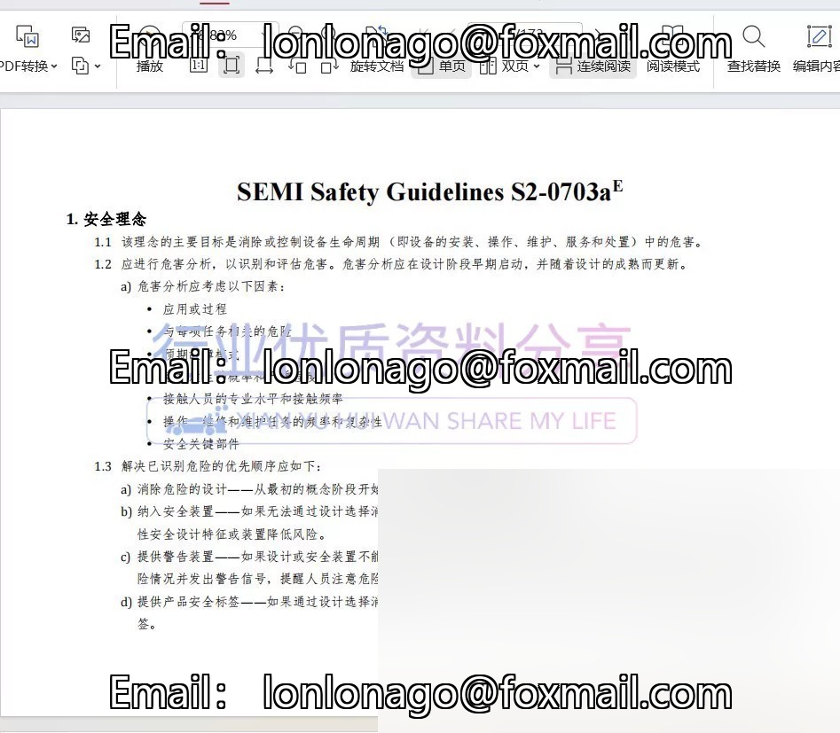
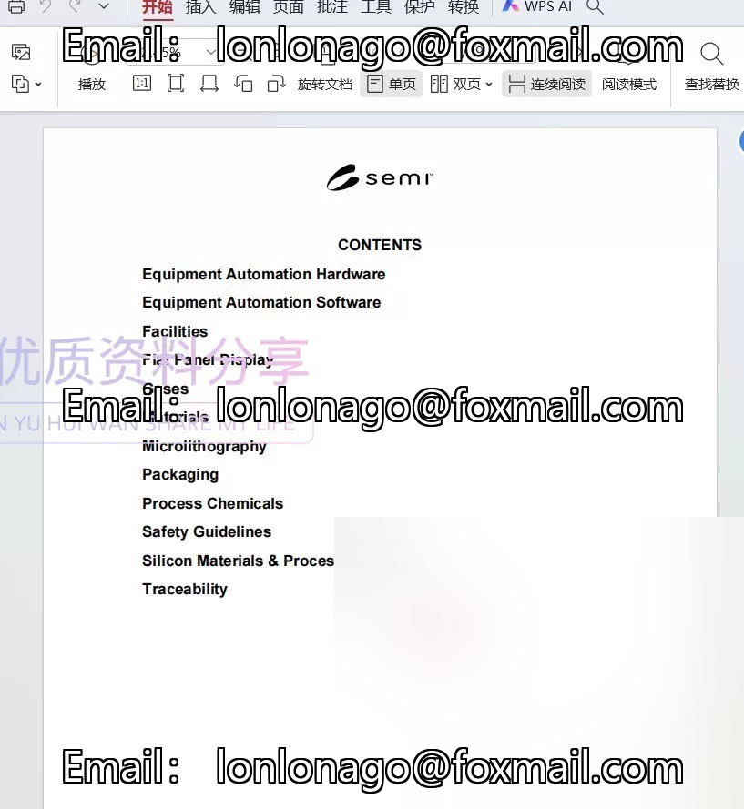
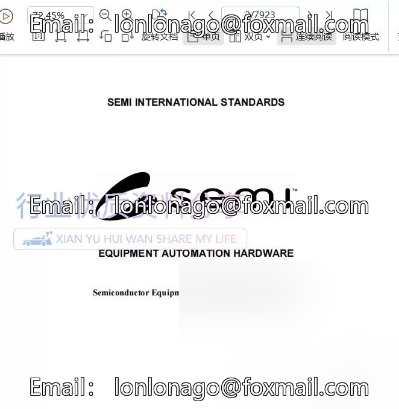
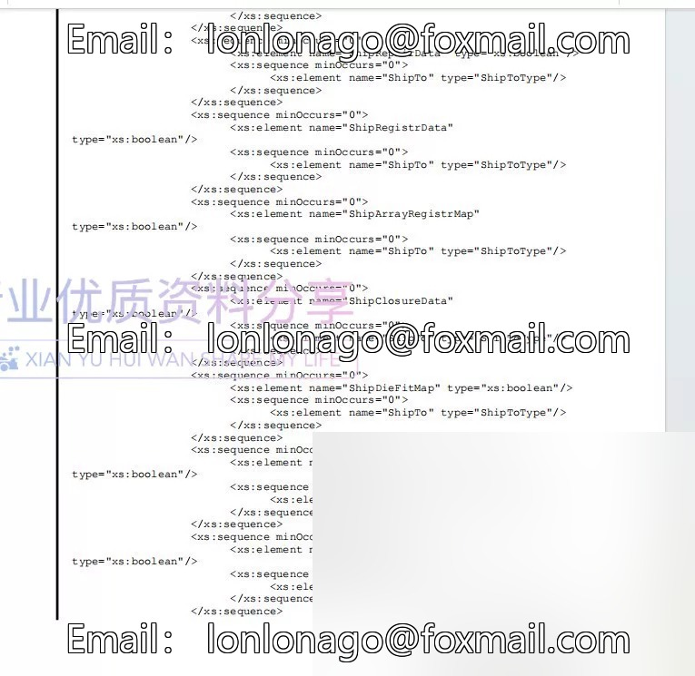
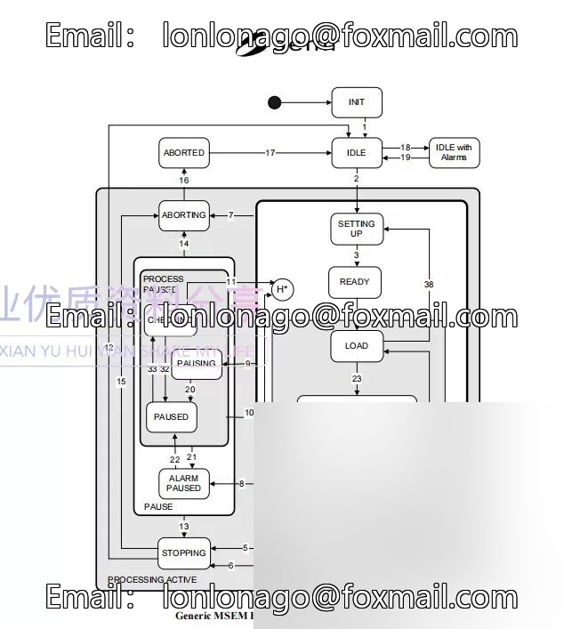
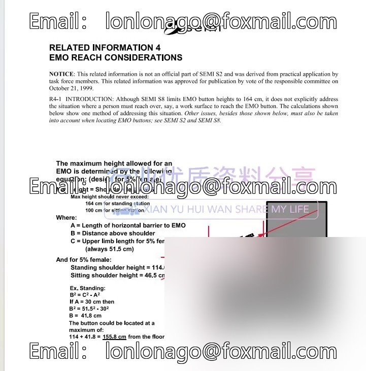

# #PDF semiconductor industry standards - very detailed - 7900+ pages, rich content

## Body

#pdf semiconductor industry standards - very detailed - 7900 pages or more, rich content, very valuable for understanding semiconductor industry processes and standards

Take a photo and immediately send the electronic original file! The following images are screenshots of the file directory. Confirm before placing the order! Due to the replicability of electronic filing materials, So after purchase, returns are not allowed! Thanks for understanding!

This PDF is a detailed semiconductor industry specification covering approximately 7,900 pages with rich content; an electronic original file is provided with a file directory screenshot, and the purchase is non-returnable.

<!-- AI_ENRICHED -->

## Images

## Payment

Here is a pay link on Stripe ( https://buy.stripe.com/3cs8yP7sY87d0vu9AB ). Please contact me lonlonago@foxmail.com after funding $89, and I will send you a complete data files , thank you!

